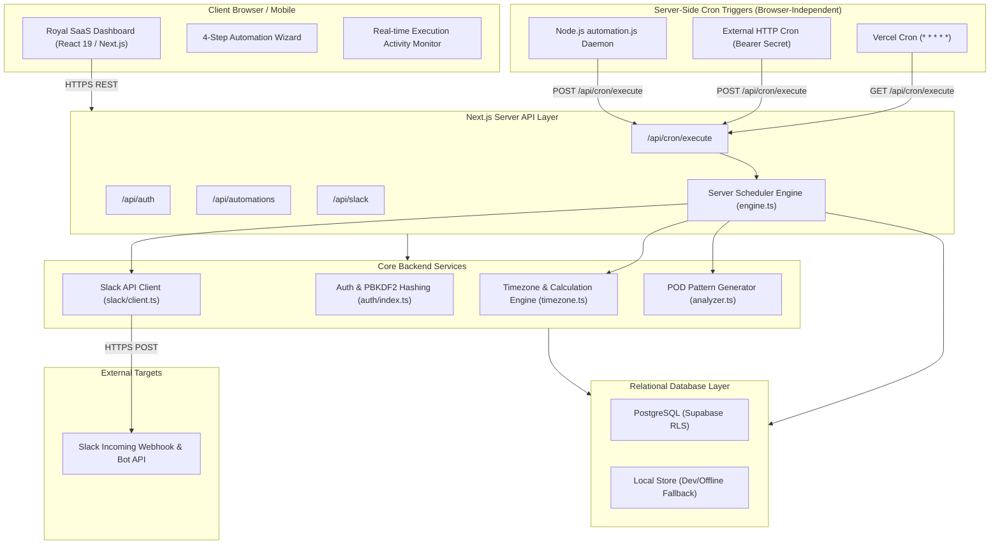

# Architecture Design Document — POD Automation

## 1. System Architecture Overview

POD Automation is built as an enterprise-grade, serverless-compatible daily opening and closing automation platform. The platform eliminates client-side timing dependencies and guarantees reliable execution across all timezones.

---

## 2. Key Architectural Layers

### A. Frontend Layer (Royal SaaS Design System)
- **Framework**: Next.js 16 App Router with React 19.
- **Design Tokens**: Pure Vanilla CSS design system (`royal-*` classes in `globals.css`).
  - Background palette: Deep Obsidian Navy (`#060913`, `#0d1424`).
  - Card surfaces: Midnight Glass (`rgba(13, 20, 36, 0.75)` with subtle `backdrop-filter: blur(16px)`).
  - Borders: Refined translucent edges (`1px solid rgba(255, 255, 255, 0.08)`).
  - Accent colors: Royal Indigo (`#6366f1`), Imperial Gold (`#eab308`), Emerald (`#10b981`), Rose (`#f43f5e`).
- **Zero Browser Schedulers**: The frontend dashboard never uses `setInterval`, `setTimeout`, or `useEffect` to trigger business executions. It acts purely as a configuration and monitoring cockpit.

### B. Autonomous Server-Side Scheduler Layer
- **Trigger Endpoint**: `/api/cron/execute`
- **Protection**:
  - Validates `Authorization: Bearer <CRON_SECRET>` or `x-vercel-cron: 1` headers.
  - Rejects unauthenticated requests with HTTP 401.
- **Execution Workflow**:
  1. Identifies active automation schedules across workspaces.
  2. Calculates local current time in each schedule's configured IANA timezone (e.g. `Asia/Kolkata`).
  3. Checks day-of-week eligibility.
  4. Checks if current time is within tolerance window (`[scheduled_minute, scheduled_minute + tolerance_minutes]`).
  5. Derives unique idempotency key: `exec_<scheduleId>_<date>_<actionType>`.
  6. Attempts atomic database reservation in `execution_logs`. If the key exists, the job is skipped immediately.
  7. Synthesizes daily task POD via deterministic team rotation engine.
  8. Dispatches payload to Slack via server-side HTTPS call.
  9. Records `delivery_logs` and marks execution status as `SUCCESS` or `FAILED`.

### C. Database Architecture (Supabase PostgreSQL)
The database enforces relational integrity, indexing, and multi-tenancy.

| Table | Purpose | Primary Key | Key Indexes |
|---|---|---|---|
| `workspaces` | Multi-tenant organization containers | UUID | `slug` |
| `users` | User credentials, roles, workspaces | UUID | `workspace_id`, `email`, `username` |
| `sessions` | Signed active session tokens | UUID | `token`, `user_id` |
| `slack_connections` | Webhook URL & Bot token storage | UUID | `workspace_id` |
| `channels` | Channel mapping and routing | UUID | `workspace_id` |
| `automation_schedules`| Schedule rules, times, days, timezones | UUID | `workspace_id`, `active` |
| `automation_actions` | Action payloads and planned actions | UUID | `schedule_id`, `scheduled_for` |
| `execution_logs` | Audit trail and idempotency locks | UUID | `execution_key`, `schedule_id`, `status` |
| `delivery_logs` | Slack message timestamps and responses | UUID | `action_id`, `created_at` |
| `past_data` | Team task bank and historical logs | UUID | `workspace_id`, `date` |
| `system_settings` | Workspace-level configuration key-values | UUID | `workspace_id`, `key` |

---

## 3. Resilient Database Abstraction

To ensure zero downtime and uninterrupted local development without external credentials:
- `SupabaseService` (`src/server/db/supabase-service.ts`) executes direct PostgreSQL queries against Supabase.
- `FallbackService` (`src/server/db/fallback-service.ts`) mirrors the exact same relational signatures against local file storage (`data/dev_store.json`).
- `dbService` (`src/server/db/index.ts`) detects whether `SUPABASE_URL` and `SUPABASE_SERVICE_ROLE_KEY` are provided and dynamically switches adapters with zero business logic alterations.

---

## 4. Slack Communication Pipeline

1. **Token Protection**: Slack tokens and webhook URLs are stored exclusively on the server. The client only receives masked representations (`https://hooks.slack.com/services/...****`).
2. **Dual-Mode Dispatch**:
   - Supports **Slack Incoming Webhooks** for simple zero-permission channels.
   - Supports **Slack Bot Tokens (`xoxb-...`)** using the Slack `chat.postMessage` Web API with explicit channel routing.
3. **Transient Failure Retry**: Network glitches or rate limits (`429 Too Many Requests`) trigger controlled exponential backoff before recording failure in `execution_logs`.
